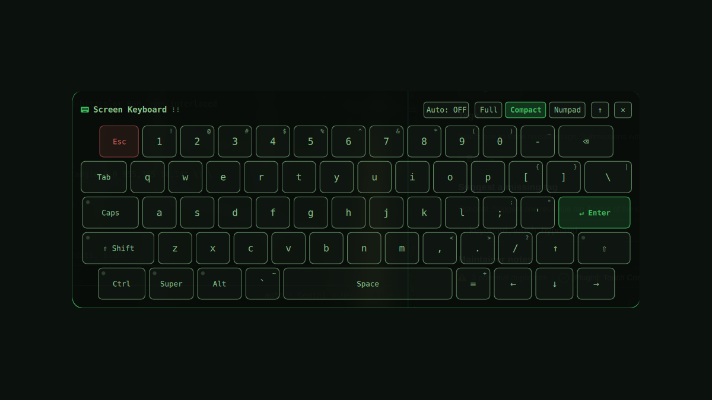

# Omarchy Lock Screen Keyboard



A companion Omarchy lock-screen plugin (`io.github.jliam2003-create.lock`) that embeds an on-screen virtual keyboard directly inside the Wayland `WlSessionLockSurface`, letting you enter your password and unlock your desktop using touch or mouse.

Works standalone or paired with [omarchy-screenkeyboard](https://github.com/jliam2003-create/omarchy-screenkeyboard).

## Features

- **Native Lock Screen Unlock**: Renders the virtual keyboard directly inside `WlSessionLockSurface` above the lock wallpaper and types directly into the password box (no external virtual keyboard daemon required while locked).
- **Quick Toggle & Auto-Pop**: Includes a `󰌌` keyboard toggle right beside the lockscreen password field, and auto-pops when Auto-Pop is enabled or when tapping the password input.
- **Synced Settings**: Automatically shares layout (`Full`, `Compact`, `Numpad`), size, position, and Auto-Pop settings with [omarchy-screenkeyboard](https://github.com/jliam2003-create/omarchy-screenkeyboard) via `~/.local/state/omarchy/screenkeyboard.json`.
- **Full Omarchy Lock Compatibility**: Preserves standard Omarchy PAM password and fingerprint authentication flows and live theme styling.

## Both Plugins in This Suite

| Plugin | Plugin ID | Purpose |
| --- | --- | --- |
| **Screen Keyboard** ([omarchy-screenkeyboard](https://github.com/jliam2003-create/omarchy-screenkeyboard)) | `io.github.jliam2003-create.screenkeyboard` | Desktop multi-touch virtual keyboard bar widget + Hyprland/Omarchy keybinding support + auto-pop on text fields |
| **Lock Screen Keyboard** (this repo) | `io.github.jliam2003-create.lock` | Lock-screen service with embedded on-screen keyboard inside `WlSessionLockSurface` for touch/mouse unlock |

## Install

### Option 1: Install via Omarchy Plugin CLI (recommended)

```bash
omarchy plugin add https://github.com/jliam2003-create/omarchy-lock-keyboard.git --enable
```

*(Recommended — also install the desktop Screen Keyboard:)*
```bash
omarchy plugin add https://github.com/jliam2003-create/omarchy-screenkeyboard.git --enable
```

### Option 2: Manual Install (`git clone`)

```bash
git clone https://github.com/jliam2003-create/omarchy-lock-keyboard.git \
  ~/.config/omarchy/plugins/io.github.jliam2003-create.lock
omarchy plugin enable io.github.jliam2003-create.lock
omarchy restart shell
```

## Uninstall

### Option 1: Uninstall via Omarchy Plugin CLI (recommended)

```bash
omarchy plugin remove io.github.jliam2003-create.lock
```

### Option 2: Manual Uninstall (if installed via `git clone`)

```bash
omarchy plugin disable io.github.jliam2003-create.lock
rm -rf ~/.config/omarchy/plugins/io.github.jliam2003-create.lock
omarchy restart shell
```

Removing this plugin restores Omarchy's built-in `omarchy.lock` service automatically.

## License

MIT — see [LICENSE](LICENSE).
